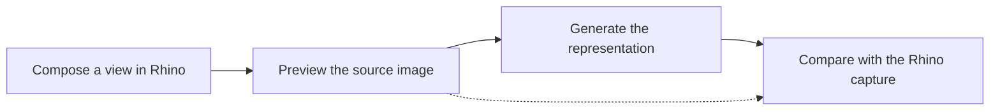

# VisoLoom

**Generative Representation for Rhino**

Turn a view you’ve composed in Rhino into a sketch, a material study or a photorealistic image. Send the view straight to the image model you choose and review the result in the VisoLoom panel.

You set the geometry, materials, lighting and camera in Rhino. The image model uses the captured view and your instructions to generate a new image, aiming to carry the design and framing through as closely as possible. Compare the result with the Rhino capture at the same zoom to check proportions, details and material boundaries.

## How a render works

Use the current viewport or a Named View with the Rhino display style you’ve set up. In VisoLoom, choose a representation, an image model and an output size. Add a prompt if there’s something specific you want the image to show. **Preview view** lets you check the frame before you render. Custom output sizes follow the proportions of the Rhino view.

Completed images save automatically on this computer. Use **Compare…** to check the full-size image and **Save PNG…** to export another copy.

## Where the render runs

| What you need | Destination | Status today |
| --- | --- | --- |
| Cloud image editing with your own key | **OpenAI** in Settings | Available in the development build. Check your connection to see your account’s models. |
| Cloud image editing with other providers | **Google** and **xAI** in Settings | Connection and model selection are in place. Live rendering still needs testing. |
| FLUX in the cloud | **Black Forest Labs** in Settings | Connection setup is available. Rendering is pending. |
| Rendering on your own computer | Local **FLUX.2 klein 4B** | Available with a local engine. Setup currently follows the development instructions. |
| Use model files you already have | **Find existing model…** in Settings | Check a folder for compatible model files. |

The panel shows where your image will go before you render. If you choose to remember an API key, VisoLoom stores it in your operating system's credential store.

## What the image model receives

For a local render, the VisoLoom engine loads the downloaded model files and runs the model on your computer. With FLUX, a text encoder turns the instructions into numbers the network can use. The model uses those instructions together with the captured Rhino view to generate the edit. The engine returns the image to the panel. [Local engine setup](engine/README.md)

For a cloud render, VisoLoom sends the prepared image, representation instructions, your prompt and the scene guidance shown in the panel to the provider you selected. Layer and material names are optional. Checking a connection sends no scene data.

## Try it today

**VisoLoom has not been released as a package yet.** Today the way to run it is from this repository: [DEVELOPMENT.md](DEVELOPMENT.md) walks through building the plug-in, installing the development copy for Rhino 8 and starting the local service — one double-click on the Mac, documented build-and-load steps on Windows. Pulling the repository alone never changes what is inside Rhino; the launcher does.

VisoLoom targets the **Rhino 8 series on Mac and Windows** with Rhino's default .NET runtime, and no later service release is required by its APIs; compatibility is confirmed release by release. Windows installation is not packaged yet. The [compatibility decision](docs/adr/0010-rhino-8-series-compatibility.md) records the details.

## Documentation

| Start here | Go deeper |
| --- | --- |
| [Product principles](docs/ux/product-principles.md) — the promises the product makes | [Accepted decisions](docs/adr/README.md) and [architecture](docs/architecture/proposed-architecture.md) |
| [User journeys](docs/ux/user-journeys.md) and [panel notes](docs/ux/panel-wireframe.md) | [Scene Package](docs/scene-package/specification.md) and the [local service protocol](docs/architecture/local-server-protocol.md) |
| [Roadmap](docs/roadmap.md) — where the work goes next | [Engine productization](docs/development/engine-productization-plan.md) · [model selection](docs/development/model-selection-plan.md) · [framing](docs/development/framing-safe-frame-plan.md) · [Library assets](docs/development/library-asset-production-plan.md) |
| [Build and run](DEVELOPMENT.md) | [Contributing](CONTRIBUTING.md) and the [current review](docs/development/phase-4-review.md) |

The planned [Library](docs/ux/library.md) follows the same principle as the render workflow: plants and context assets are placed and edited in Rhino itself, already close to the intended result, and the image refines what is visibly there.

## Licence

VisoLoom's source is licensed under **GPL-3.0-or-later** — see [LICENSE](LICENSE) and the [licence status](docs/legal/licensing-status.md); the analysis behind the choice is in the [decision memo](docs/legal/software-licence-decision.md). The GPL covers the code: anyone may use, study, modify and redistribute it, including commercially, with distributed changes published under the same terms. The **VisoLoom name is not licensed by the GPL** — and neither are the brand identity assets in `assets/brand`, which stay with their creator. Derivative distributions carry their own name and may not imply endorsement. Bundled-library notices will be recorded before any binary distribution.

The [VisoLoom repository](https://github.com/PascalNun/VisoLoom) is public under GPL-3.0-or-later. Architectural fidelity, native acceptance and packaging remain open work — recorded honestly in the [current review](docs/development/phase-4-review.md). No packaged release or Yak publication exists yet.
