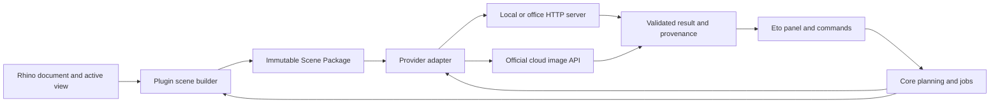

# Proposed component architecture

Status: accepted architecture; first-slice code implemented on 2026-10-11. Supported-host validation remains open. See the [implementation review](../development/phase-4-review.md).



The diagram shows intended runtime flow, not assembly references. Shared Core has no Rhino, Eto, network, or UI dependency.

The plug-in and shared libraries target `net7.0` against the original Rhino 8 SDK, supporting the Rhino 8 series on its default .NET 7 and .NET 8 runtimes. The independent server targets `net10.0`. Native compatibility still requires host testing; [ADR 0010](../adr/0010-rhino-8-series-compatibility.md) records the target and evidence.

## Boundaries and repository

```text
src/
  VisoLoom.Core/           neutral records, validation, planning, prompts, jobs
  VisoLoom.Plugin/         commands, Eto, scene extraction, host bitmap bridge
  VisoLoom.Providers/      adapter contract consumers, local HTTP adapter, cloud stubs
  VisoLoom.Protocol/       versioned HTTP DTOs and shared wire validation
server/
  VisoLoom.ReferenceServer/ ASP.NET Core development service
tests/
  VisoLoom.Core.Tests/
  VisoLoom.Protocol.Tests/ HTTP integration and provider transport fixtures
docs/                     research, architecture, ADRs, UX, legal, development
examples/                 synthetic fixtures, sample manifests, preset data
.github/workflows/        Windows/macOS build and tests
```

These directories now contain the first-slice implementation. Scene Builder remains a namespace in the plug-in until another host needs it. No DI framework, dynamic plug-in loader, separate camera model, database service, browser UI, Python interpreter, or ML dependency is required in Rhino.

Core defines `SceneManifest`, `ProviderCapabilities`/`ModelCapabilities`, `RenderIntent`, `ResolutionPlan` and `RenderResult`. Protocol owns the reference server’s `JobResponse` and wire submission records; provider-neutral results carry an optional remote job ID, so a later synchronous cloud API need not invent a server job. The provider boundary exposes discovery and asynchronous execution with progress/cancellation. A small credential-store interface lives at the infrastructure boundary, outside serialized domain records. The protocol references neutral Core DTOs where appropriate; Core never references Protocol. The plug-in composes dependencies explicitly.

`VisoLoom` opens the native panel. `VisoLoomRender` submits the same render action for Rhino commands/macros. Settings lives in the panel; batch is deferred. Existing Rhino Render behavior and selected renderer are untouched.

## One job, one snapshot

1. Resolve the selected provider/model and current policy. Discover capabilities before expensive capture.
2. Read current viewport dimensions and plan the output using Core. Reject unsupported requirements with a user-readable explanation.
3. On the Rhino UI thread, bind an explicit document/viewport, freeze camera, clipping, visibility, materials, and relevant revision state. Capture reference and any negotiated passes from that state. Never use `ActiveDoc` after an asynchronous continuation to identify the original job.
4. Validate snapshot consistency. If the view/document changed during a capture sequence, discard the incomplete package and report that a new capture is needed. Do not mix revisions or silently use a later view.
5. Release Rhino resources. Encode only where the host bitmap lifetime/threading permits; use owned bytes/files for background hashing, uploads, and inference. A UI-thread capture may briefly block; measure and bound it rather than claiming complete nonblocking behavior.
6. Store the finalized package atomically in per-user application data. Send the minimal permitted projection of it to the adapter. No provider is allowed to query Rhino.
7. Validate returned MIME, file size, decoded dimensions, and the resolution plan. Perform only declared deterministic processing. Save result/provenance externally and update the panel on the UI thread.

While inference runs, the architect can keep modelling. The job's readout and preview retain the captured view; the panel can separately show the current Rhino view. Closing a panel must not lose the job. Closing a document must detach UI access and retain the already-captured result with its provenance; pre-capture work is cancelled.

## First vertical slice

Reference capture, full camera metadata, eligible visible layer/material metadata with provenance, JSON/PNG validation, capabilities, asynchronous local job, byte-identical PNG return, result/source comparison and Save. One in-flight user job initially. The reference service advertises a bounded queue for protocol testing, one output, no image editing, no generative prompt effect, and no auxiliary control passes.

Available material metadata is not pixel visibility proof: without an ID pass, label it as eligible scene metadata and state unresolved instance or occlusion limitations. Do not infer hidden-object appearance or claim every material is visible in the image.

Cloud families are explicit `NotImplemented` descriptors and never selectable for execution. Normal generation presets become usable when a real adapter exists. Editable preset data may be added during scaffold, including the supplied Competition Sketch instructions.

## Reference image and visible intent

The architect establishes the intended appearance in Rhino. Capture that appearance as the main reference for an image edit: geometry, recognizable assets, material character and deliberate lighting should already communicate the design. Preparation depends on the task. A concept sketch can start with simple surfaces; a faithful realistic visualization benefits from representative textures, correct mapping scale and visible lighting. A completed conventional render is not a prerequisite.

Default to the **actual active viewport and its chosen display mode**, preserving camera, complete frame, visibility, sections and visible material assignments. Do not silently switch to a different mode, strip edge lines, recolor surfaces, change the sun or reconstruct the scene. Show the exact source image before submission. The user's rendered style with ambient occlusion and edges is a priority validation candidate, not an unsupported assumption that every custom mode works today.

For realistic output, compare that style with a matched capture using lighter or absent outlines and deliberate sun/scene shadows. Lines and strong ambient occlusion may influence the generated appearance; whether they help geometry retention or create unwanted dark outlines must be measured with the chosen model. Ambient occlusion communicates local occlusion, not a specific solar direction. Rhino's [display lighting](https://docs.mcneel.com/rhino/8/help/en-us/options/view_display_mode_lighting_scheme.htm) and [Sun](https://docs.mcneel.com/rhino/8mac/help/en-us/commands/sun.htm) remain the controls. Do not create a second lighting editor.

| Input | Role |
| --- | --- |
| Main appearance image | The chosen Rhino capture, with intended surface appearance, asset form and visible lighting. Begin with one source image. |
| Bounded scene descriptions | Add material identity/finish, asset character and known section context. The adapter translates only useful, authorized information into supported API inputs; Scene Package JSON is not automatically understood as spatial control by an image model. |
| Optional aligned passes | Edges, depth or IDs have separate declared roles and identical framing. Add them only after the adapter demonstrates useful consumption. False-color IDs do not replace the appearance image; arbitrary extra reference images are not equivalent to native control inputs. |

For example, concrete should already have an appropriate visible tone, finish and texture scale where those are decided. Its description can distinguish fine board-marked concrete from coarse exposed aggregate. Text alone cannot reliably associate a material GUID or layer name with pixels. Changing an intentionally different appearance requires an explicit architect request and tested regional support where localization is claimed. Future material-reference images need a separate purpose, authorization and adapter capability; raw texture maps are not uploaded by default.

When sun direction matters, establish it in Rhino and capture its actual visible shadows. Aim to retain direction, shadow footprints and intended surface response. A generated image is not a verified sunlight analysis or a physically accurate renderer. Future lighting provenance should record useful derived direction and relevant settings where reliably available, minimizing disclosure of project location. The current manifest does not extract a complete lighting state or texture/PBR setup.

A future explicit input from a completed Rhino render may be useful for realistic studies. It must prove the same camera, framing, clipping and scene state, and define render completion. Raytraced convergence and arbitrary imported render alignment are unvalidated; neither is enabled or substituted automatically by this plan.

This is an input strategy to benchmark, not a claim that a closer-looking reference guarantees a better or unchanged output. Official [image-editing guidance](https://developers.openai.com/api/docs/guides/image-prompting) supports identifying each reference's role and separating requested edits from details to retain. The first real adapter must compare the user's custom rendered/AO/edge style, a matched restrained-line capture and, when supported, a completed conventional render. Hold scene, framing, intent and output plan constant; evaluate multiple outputs for architectural drift, material tone/texture scale, asset character, edge artifacts and shadow direction/footprints. Style preference alone is insufficient.

**Current boundary:** the test captures only built-in Wireframe, Shaded and Rendered. Custom modes, Raytraced and complete lighting/material extraction remain unvalidated. Texture appearance can be present in captured pixels without its source files or full shader parameters being extracted. The reference server returns those pixels unchanged; no image model or additional pass is connected.

## First-slice acceptance criteria

- Plug-in compiles against a pinned Rhino 8 SDK and loads on the proposed supported host; CI compilation is reported separately from in-Rhino testing.
- Perspective and parallel framing survive viewport/2×/4× capture and round trip, including odd aspect ratios. Two-point perspective is tested before being advertised.
- Returned reference PNG has the same hash and dimensions as uploaded reference; source and output labels explain passthrough behavior.
- Normal object/layer/default material metadata and view-specific clipping metadata serialize without secrets or absolute local paths; complex unsupported assignments are explicit.
- Slow server, invalid response, authentication failure, cancellation, timeout, and disk-full states leave Rhino usable and preserve meaningful job status.
- Capture does not change the Rhino camera, Named Views, materials, layers, selection, undo state, or saved document state. If a cleanup policy cannot suppress viewport adornments without mutation, disclose that limitation.
- No `.3dm`, unused pass, texture file, or provider secret is uploaded.

See [development plan](../../DEVELOPMENT.md) for release gates and tests.

## Geometry-preservation criteria for generative milestones

Each real-provider integration must aim to preserve the supplied architecture, terrain, hardscape, openings, stairs, proportions, composition and section geometry. Choose and tune reference inputs, useful supported guidance passes and prompt composition toward that objective. The reference-only milestone establishes a trustworthy input; it does not complete the product's fidelity work.

Evaluate generated results against architectural fixtures with known openings, step counts, border landmarks and section voids. Record invented, removed or moved features and proportion changes separately from style preference. Treat those deviations as defects, and use measured improvements to guide provider/pipeline selection. A model's ability to produce visually appealing images alone is insufficient evidence of suitability. Define practical benchmark thresholds from those experiments without claiming guaranteed geometry preservation or complete automatic defect detection.
