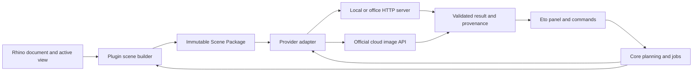

# Proposed component architecture

Status: accepted architecture; first-slice code implemented on 2026-10-11. Supported-host validation remains open. See the [implementation review](../development/phase-4-review.md).



The diagram shows intended runtime flow, not assembly references. Shared Core has no Rhino, Eto, network, or UI dependency.

## Boundaries and repository

```text
src/
  VisoLoom.Core/           neutral records, validation, planning, prompts, jobs
  VisoLoom.Plugin/         commands, Eto, scene extraction, host bitmap bridge
  VisoLoom.Providers/      adapter contract consumers, local HTTP adapter, cloud stubs
  VisoLoom.Protocol/       versioned HTTP DTOs and shared wire validation
server/
  VisoLoom.ReferenceServer/ ASP.NET Core development service
tests/
  VisoLoom.Core.Tests/
  VisoLoom.Protocol.Tests/ HTTP integration and provider transport fixtures
docs/                     research, architecture, ADRs, UX, legal, development
examples/                 synthetic fixtures, sample manifests, preset data
.github/workflows/        Windows/macOS build and tests
```

These directories now contain the first-slice implementation. Scene Builder remains a namespace in the plug-in until another host needs it. No DI framework, dynamic plug-in loader, separate camera model, database service, browser UI, Python interpreter, or ML dependency is required in Rhino.

Core defines `SceneManifest`, `ProviderCapabilities`/`ModelCapabilities`, `RenderIntent`, `ResolutionPlan` and `RenderResult`. Protocol owns the reference server’s `JobResponse` and wire submission records; provider-neutral results carry an optional remote job ID, so a later synchronous cloud API need not invent a server job. The provider boundary exposes discovery and asynchronous execution with progress/cancellation. A small credential-store interface lives at the infrastructure boundary, outside serialized domain records. The protocol references neutral Core DTOs where appropriate; Core never references Protocol. The plug-in composes dependencies explicitly.

`VisoLoom` opens the native panel. `VisoLoomRender` submits the same render action for Rhino commands/macros. Settings lives in the panel; batch is deferred. Existing Rhino Render behavior and selected renderer are untouched.

## One job, one snapshot

1. Resolve the selected provider/model and current policy. Discover capabilities before expensive capture.
2. Read current viewport dimensions and plan the output using Core. Reject unsupported requirements with a user-readable explanation.
3. On the Rhino UI thread, bind an explicit document/viewport, freeze camera, clipping, visibility, materials, and relevant revision state. Capture reference and any negotiated passes from that state. Never use `ActiveDoc` after an asynchronous continuation to identify the original job.
4. Validate snapshot consistency. If the view/document changed during a capture sequence, discard the incomplete package and report that a new capture is needed. Do not mix revisions or silently use a later view.
5. Release Rhino resources. Encode only where the host bitmap lifetime/threading permits; use owned bytes/files for background hashing, uploads, and inference. A UI-thread capture may briefly block; measure and bound it rather than claiming complete nonblocking behavior.
6. Store the finalized package atomically in per-user application data. Send the minimal permitted projection of it to the adapter. No provider is allowed to query Rhino.
7. Validate returned MIME, file size, decoded dimensions, and the resolution plan. Perform only declared deterministic processing. Save result/provenance externally and update the panel on the UI thread.

While inference runs, the architect can keep modelling. The job's readout and preview retain the captured view; the panel can separately show the current Rhino view. Closing a panel must not lose the job. Closing a document must detach UI access and retain the already-captured result with its provenance; pre-capture work is cancelled.

## First vertical slice

Reference capture, full camera metadata, eligible visible layer/material metadata with provenance, JSON/PNG validation, capabilities, asynchronous local job, byte-identical PNG return, result/source comparison and Save. One in-flight user job initially. The reference service advertises a bounded queue for protocol testing, one output, no image editing, no generative prompt effect, and no auxiliary control passes.

Available material metadata is not pixel visibility proof: without an ID pass, label it as eligible scene metadata and state unresolved instance or occlusion limitations. Do not infer hidden-object appearance or claim every material is visible in the image.

Cloud families are explicit `NotImplemented` descriptors and never selectable for execution. Normal generation presets become usable when a real adapter exists. Editable preset data may be added during scaffold, including the supplied Competition Sketch instructions.

## First-slice acceptance criteria

- Plug-in compiles against a pinned Rhino 8 SDK and loads on the proposed supported host; CI compilation is reported separately from in-Rhino testing.
- Perspective and parallel framing survive viewport/2×/4× capture and round trip, including odd aspect ratios. Two-point perspective is tested before being advertised.
- Returned reference PNG has the same hash and dimensions as uploaded reference; source and output labels explain passthrough behavior.
- Normal object/layer/default material metadata and view-specific clipping metadata serialize without secrets or absolute local paths; complex unsupported assignments are explicit.
- Slow server, invalid response, authentication failure, cancellation, timeout, and disk-full states leave Rhino usable and preserve meaningful job status.
- Capture does not change the Rhino camera, Named Views, materials, layers, selection, undo state, or saved document state. If a cleanup policy cannot suppress viewport adornments without mutation, disclose that limitation.
- No `.3dm`, unused pass, texture file, or provider secret is uploaded.

See [development plan](../../DEVELOPMENT.md) for release gates and tests.

## Geometry-preservation criteria for generative milestones

Each real-provider integration must aim to preserve the supplied architecture, terrain, hardscape, openings, stairs, proportions, composition and section geometry. Choose and tune reference inputs, useful supported guidance passes and prompt composition toward that objective. The reference-only milestone establishes a trustworthy input; it does not complete the product's fidelity work.

Evaluate generated results against architectural fixtures with known openings, step counts, border landmarks and section voids. Record invented, removed or moved features and proportion changes separately from style preference. Treat those deviations as defects, and use measured improvements to guide provider/pipeline selection. A model's ability to produce visually appealing images alone is insufficient evidence of suitability. Define practical benchmark thresholds from those experiments without claiming guaranteed geometry preservation or complete automatic defect detection.
