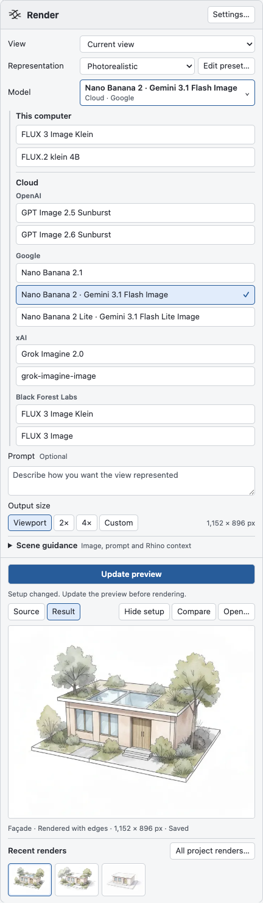

# Render panel

Accepted design direction, 2026-11-27. This is the implementation target for the Rhino dock. The first native implementation covers setup layout, the grouped model picker, and a scrollable project list using the current index. Docked visual validation, the expanded preset workflow, and full history storage remain open.

[Interactive mockup](render-panel-mockup.html) · [Settings design](settings-mockup.html). GitHub shows the HTML source. Download or clone the repository and open the mockup in a browser to try the controls. It uses authored façade-study images and simulates model choice, settings, preset editing, and rendering without a connection.

## Layout and controls

Use native Rhino/Eto controls and theme colors. Keep the vertical order at narrow and wide widths, with labels stacked where needed. Start with a small logo, **Render**, and a visible **Settings…** action in the header. It opens the existing Settings control and remains available when setup is hidden. When Library is ready, put workspace navigation in the header. An image-focused **Hide setup** / **Show setup** action belongs with the image controls.

| In order | Interaction |
| --- | --- |
| **View** | Choose the current view or a Rhino Named View. Retain the existing Named View browser and explicit **Show named view in Rhino** action. Rhino owns views and cameras. |
| **Representation** | Choose a built-in or personal preset. **Edit preset…** belongs beside the selector, with stacking at narrow widths. |
| **Model** | Choose one concrete model. The closed control shows its name and where it runs. Keep project pin actions available near this field. |
| **Sampling steps** | Show this near Model for a local profile with a documented override. Start with that model's default, then show valid steps. |
| **Prompt** | Optional additions specific to this image. Keep the text when switching model or representation. |
| **Output size** | Keep **Viewport**, **2×**, **4×**, and **Custom** visible. In Custom support direct entry of both dimensions, aspect lock, and the existing safe-frame behavior. Show the requested output size and disclose provider scaling or padding before submission. |
| **Scene guidance** | Collapsed by default and in a stable place. Summarize what the destination uses. Under it, retain **View full prompt…** for the prepared request. |
| **Preview / Render** | One primary action reflecting readiness. Preserve the reviewed capture flow below. |
| **Image and history** | One shared image surface, then Recent renders. Show Source, Result, Compare, and access to opening and exporting a full-resolution file. |

### Choose the exact model

Open one picker with equally wide, left-aligned rows. Separate **This computer** from **Cloud** with a divider. Give OpenAI, Google, xAI, and Black Forest Labs their own headings within Cloud. Each child row is a specific model and selecting it closes the picker. Mark the selected row with both a check and a theme-aware highlight. Display the exact model and destination when the picker closes. Where a family name is ambiguous, add a model or version label, such as **Nano Banana 2 · Gemini 3.1 Flash Image**. The examples in the mockup illustrate grouping. Populate the shipped picker from installed local capabilities and each provider's currently available, supported image-edit profiles.

Settings handles connection, credential, model discovery, and installation. Opening the picker or selecting a model makes no generation request. Retain the view, representation, prompt, and requested output size on a switch. Revalidate size and expire incompatible previews. Leave an unavailable project pin visible with its reason and a Settings recovery action. Defer other destinations until the production transport supports them. Keep the internal capture test available through diagnostics.

### Representations

Keep built-ins as stable starting points, specify their look in a one-sentence description, and write concrete style instructions about linework, lighting, tonal range, or texture. Keep project-independent geometry and framing instructions in the shared composer. Keep built-in names and contents intact. Personal presets live with user settings and can be named, updated, duplicated, or deleted with confirmation.

In the editor, **Save as new preset…** creates a personal copy of the displayed draft. **New preset** starts with blank fields. **Save preset** updates a personal preset. **Reset changes** reloads the fields as they were when the editor or draft opened. It never writes to storage. Group personal choices under **My presets** as they are added. Avoid a UI quota and keep bounded storage and clear save errors. Preserve preset identity and revision in render provenance. The existing editor, copy and delete flows already work. Blank creation, grouped choices, and draft reset are the UI changes to implement. [Preset storage and editing decision](../adr/0029-personal-preset-editor.md)

### Preview and progress

The native workflow first prepares the exact model input, then renders that reviewed image with its prepared prompt. Use **Preview view** when there is no capture, **Update preview** when inputs change, and **Render view** when the reviewed preview is ready. Selecting an older result does not replace the next render's source. Preserve the last usable image during preparation or provider failure. Show measured step progress when the local runner reports it. For cloud wait states, show the provider with elapsed time or indeterminate progress. Label a local cancellation **Cancel** and a provider wait that cannot cancel generation **Stop waiting**. [Reviewed preview contract](../adr/0015-preview-before-submission.md)

## Recent renders and project history

Keep up to three newest thumbnails under the image. This is quick access. Add **All project renders…** next to the strip. It opens a bounded-height, vertically scrolling list or native dialog for the active project, newest first. Selection shows that render in the existing image surface. Keep Open and Save PNG available where the image exists. Enable Compare when the original source is available. Show a readable missing-file row when a saved output has been moved or is on another machine. Load thumbnails as needed and full images on selection. Prefer project history to an ever-growing dock.

Today the panel holds up to three source/result pairs in memory, subject to its memory budget, and shows up to three thumbnails. **All project renders…** also exposes indexed files. The persisted .3dm index is bounded to at most twelve output references and only records successful saves. Its current rows include file paths, not pixels, and saved files beyond the index cannot all be rediscovered by this picker. [Current project render index](../adr/0034-project-render-index.md)

The scrollable list merges session and indexed project results, deduplicated by result ID. Full project history is a persistence follow-up. Keep a stable project identifier and a durable, paged catalogue of saved result references outside the image viewer. Reuse the existing index to bring older supported rows forward. Keep image files on disk. If an archive moves, offer relinking or a missing-file state. Retaining all project renders means retaining all saved output references for that project, subject to user-managed files and availability. Source-pair retention, cross-machine folder portability, and files already beyond the current index are separate storage concerns to settle before calling history complete.

## Implementation sequence

1. Reorganize the native panel and add the grouped, exact-model picker using the existing Settings and capture/job contracts.
2. Refine preset editing and the result workspace. Add the scrollable project list over the current data and retain existing Open, Compare, and Save PNG paths.
3. Extend project history persistence and verify save/reopen, more than twelve renders, missing/moved files, and no duplicate rows.
4. Validate the layout docked at narrow and wide widths in Rhino on macOS and Windows, in light and dark themes and with keyboard navigation. Verify that switching models invalidates the prepared input with no upload, presets retain the optional prompt, and project history does not increase the dock's height.

Review [scene-guidance evidence](../architecture/material-appearance.md) before changing what is sent. The panel cleanup can ship independently of the context experiments.
